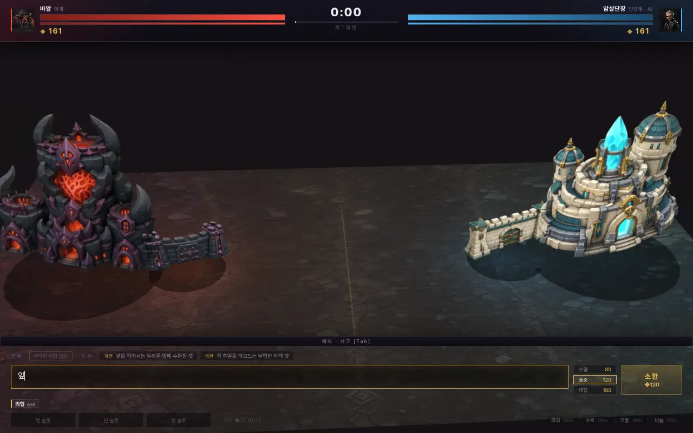
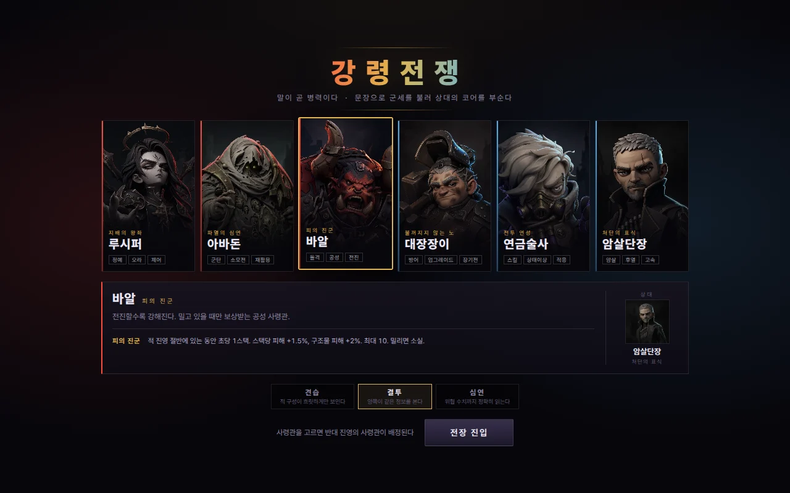

# Tongue of War

**강령전쟁** is a browser tug-of-war strategy game where you summon units by writing
Korean sentences. Your opponent is an LLM writing sentences under the same rules, or a
scripted bot if no API key is set.



<sub>`앞을 막아서는 두꺼운 탱크 셋` ("three thick tanks that hold the line") becomes three
rune landships. At the 12-second wave the opponent (gpt-6-luna here) answers with its own
sentence, which goes through the same parser. Recorded headlessly with
`tools/record-demo.mjs`.</sub>

## The idea

Letting players type what they want is the easy part. Keeping that from breaking the
game is the hard part: if a model's output can set stats, someone will ask for an
invincible dragon and get one. So nothing anyone writes, player or model, becomes a number
directly. The words pick a description; the compiler decides the stats.

```
sentence ─┬─> parser ─────────> UnitIntent ──> BP compiler ──> unit stats
          │   (Korean lexicon)  enums, -3..3     the only place numbers are made,
          │                     priorities,      inside the ritual's budget
          │                     count 1/2/3/5,
          │                     skill ids
          └─> appearance parser ──> VisualIntent ──> renderer (never read by the compiler)
```

`HP 999999 무적 최강 드래곤` ("HP 999999 invincible strongest dragon") compiles to exactly
the same unit as `드래곤 하나` ("one dragon"). The number is not filtered out; there is no
field for it to land in. The receipt under the input box shows which words did what, and
which did nothing.

This is a narrow claim. It does not make the model behave and it does not make every
sentence a good one. It guarantees that whatever is written becomes a legal unit within
its budget. `npm test` fuzzes the compiler with thousands of random sentences and
malformed intents to keep that true; it found two holes while it was being written.

The LLM opponent plays by the same rules. The browser sends the server a public
battlefield snapshot, the server builds the prompt, the model writes one Korean sentence,
and the client prices it exactly like yours: same parser, same compiler, same context
discount and repeat surcharge. The model picks tactics, never stats. Without a key, a
scripted bot picks sentences from a fixed book and sends them through the same parser and
compiler at list price.

## Run it

Node 20.12 or newer.

```bash
git clone https://github.com/Jayyo/tongue-of-war.git
cd tongue-of-war
npm install
npm start            # http://127.0.0.1:8123
```

That plays against the scripted bot. For an LLM opponent, set a key before `npm start` or
copy `.env.example` to `.env`:

```bash
OPENAI_API_KEY=sk-... npm start
```

| Variable | Default | |
|---|---|---|
| `OPENAI_API_KEY`, `GEMINI_API_KEY`, `DEEPSEEK_API_KEY` | unset | checked in this order; the first one set picks the provider |
| `LLM_PROVIDER` | auto | `openai`, `gemini`, `deepseek` or `openai-compatible` |
| `LLM_MODEL` | `gpt-6-luna`, `gemini-3.5-flash`, `deepseek-chat` | |
| `LLM_REASONING_EFFORT` | `none` (OpenAI), `minimal` (Gemini) | dropped automatically if the model rejects it |
| `LLM_BASE_URL`, `LLM_API_KEY` | unset | any OpenAI-compatible server, e.g. a local Ollama; takes precedence when set |
| `PORT`, `HOST` | `8123`, `127.0.0.1` | |

The defaults are fast models with reasoning turned down. A wave is 12 seconds; with the
game's real prompt gpt-6-luna answered in 1.3 to 2.3 s, while larger reasoning models took
5 to 7 s and sometimes spent their whole output budget thinking.

## How to play

The input is Korean, but you do not need much of it: the suggestions above the box can be
clicked, and the receipt tells you what each word did. A few HUD words: 영기 essence,
소환 summon, 각인 engrave, 연성 transmute, 전황 signals, 추천 suggestions, 국면 phase
(a 12 s wave); the roles are 수호자 guard, 습격자 raider and 포격수 artillery.



1. Pick a commander. Each owns one lever: Baal gets stronger while pushing, the Alchemist
   can flip an engraved design between physical and arcane damage, and so on. The other
   realm's commander is assigned to the AI.
2. Pick a ritual size (80, 120 or 180 essence, which is also the unit's budget), write a
   sentence describing a unit and press Enter.
3. Summons land immediately, then a 4 second command lock. Essence keeps coming in.
4. Like a design? Engrave it (각인) into one of three slots and re-cast it later at 0.8x.
5. Watch the signals row (전황). A sentence that answers a live threat with a fitting
   mechanism is 20% cheaper and the unit really gets that behaviour. Repeating the same
   tactic costs more each time.
6. Break the enemy core before yours breaks. A match takes about six minutes.

| Sentence | Meaning | Becomes (neutral commander, 120 BP, cohort totals) |
|---|---|---|
| `앞을 막아서는 두꺼운 방패병 셋` | three thick shieldmen who hold the line | guard x3, 1728 HP, 65 DPS |
| `적 후열을 파고드는 날렵한 그림자 자객 셋` | three swift shadow assassins who dive the enemy back line | raider x3, speed 5.0, hunts the back line |
| `멀리서 꿰뚫는 강철 장궁대` | a steel longbow company that pierces from afar | artillery x3, 7 m range |
| `광역으로 휩쓰는 화염 폭발 술사` | fire-blast casters that sweep an area | artillery, arcane, splash |
| `얼음으로 적을 둔화시키는 냉기 술사 셋` | three frost casters who slow the enemy | artillery, arcane, chill |
| `보호막을 두른 견고한 강철 골렘 둘` | two sturdy steel golems wrapped in a shield | guard x2 with a ward, drawn as colossi |
| `적 탱커를 처형하는 무자비한 도끼병 셋` | three ruthless axemen who execute the enemy's tanks | raider x3, execute, hunts the highest HP |
| `탱크 셋` | three tanks | guard x3, drawn as landships |
| `늑대 다섯` | five wolves | raider x5, drawn as quadrupeds |
| `드래곤 하나` | one dragon | elite raider, arcane, drawn with wings |
| `HP 999999 무적 최강 드래곤` | "HP 999999 invincible strongest dragon" | the same dragon; 무적 is flagged 규칙상 불가 (not allowed) |

Words the combat parser does not know show up as `외형 전용` (appearance only). They never
change stats, though the appearance parser may still use them for the unit's look.

## How it works

- `src/gen/interpreter.js`, `src/gen/lexicon.js`: the parser. Longest match first, and a
  matched span is consumed, so `단독` (alone) is never re-read as `독` (poison). The phrase
  after `적` (enemy) sets the target, not the unit.
- `src/domain/budget.js`: the compiler. Convex costs for range and speed, a surcharge for
  stacking range, speed and damage, resistance priced against every survival pool, and
  role ranges as hard limits.
- `src/domain/signals.js`: battlefield signals, context claims and the repeat surcharge,
  which compares tactics rather than wording.
- `src/engine/sim.js`: fixed 50 ms ticks, no DOM, no `Math.random()`. Each tick plans
  against frozen state and applies damage at once; the first version did not, and
  identical armies on both sides went 12/12 to the left.
- `src/ai/`: the server-built opponent prompt and the scripted bot, which uses the same
  sentence path.
- `src/ui/`: three.js renderer with cut-out rigs: an 11-part biped (scaled up for golems
  and giants), a siege rig, and quadruped and winged rigs.

[docs/design.md](docs/design.md) has the reasoning behind the cost model, counters, tempo
and the opponent.

## Tests and the balance harness

```bash
npm test                      # parser, compiler fuzz, determinism, mirror fairness, snapshot validation (~2 s)
npm run balance               # headless balance sweep on the same sim the browser runs (~45 s)
npm run balance:mirror        # order-fairness gate only
npm run smoke                 # plays a match opening in headless Chromium
npm run smoke -- --mock-llm   # same, with a fake local model behind /api/opponent
```

The smoke test needs `npx playwright install chromium` once. It starts the server with
`--no-dotenv` and no provider variables, so it never spends your keys. Current harness
output, abridged:

```
=== Order fairness: the same cohort on both sides (left win rate of decided games, target 45-55%) ===
  wall      no winner in 12/12 (simultaneous wipes 6, timeouts 6)
  assassin  no winner in 12/12 (simultaneous wipes 7, timeouts 5)
  cannon    no winner in 12/12 (simultaneous wipes 12, timeouts 0)
  ...
  -> max bias 0 pp (pass)

  fight length: p10 6.9s / p50 12.8s / p90 30.4s  (target p50 10-14 s, p10 >= 7 s)
  winner's surviving value: p50 36%  (target 15-30%)
  PROMPT_VIABILITY=PASS
  FORMATION_GATE=PASS

=== Commander matches, bot vs bot (sides alternate, 8 seeds per pairing) ===
  lucifer vs smith           demon win rate  88%
  abaddon vs smith           demon win rate  13%
  baal vs alchemist          demon win rate 100%
  ...
  match length: p10 4:23 / median 6:29 / p90 8:48  (target median 6:30)
```

Not everything is green; see the limitations.

## Art

The game's artwork was generated with OpenAI's gpt-image-2 from the prompts in
`tools/gen-*.mjs`, on a flat green background so it can be keyed exactly, then cut, sliced
into rig parts with pivots (`tools/cut-chroma.py`, `tools/slice-*.py`) and converted to
WebP (`tools/webp.py`). Each unit's parts come from a single generated sheet so the pieces
share one costume and palette. The art is CC BY 4.0; see [NOTICE](NOTICE).

## Limitations

- Korean input only. The parser is a dictionary matcher, not a language model; plenty of
  reasonable sentences parse poorly, which is why the receipt exists.
- Balance is unfinished. The winner of a cohort duel keeps more of its army than the
  target; bot-vs-bot commander pairings are lopsided (the demon side wins 50 to 100% in 7
  of 9); guards and artillery already move at their role's speed cap, so `느린` (slow)
  makes only raiders slower (for the others it just shifts the HP/damage split); and in
  the duel harness veiled raiders slip past the other cohort, so their row of the matchup
  matrix is all draws.
- Some appearance concepts (catapult, cannon and others) have no parts yet and fall back
  to the role's silhouette, marked with △.
- Single player against the AI, desktop only. No online play, replay viewer or sound.
- The server is meant for local play. It binds to 127.0.0.1, accepts API calls only from
  its own (unframeable) page, builds every prompt itself (the only free text it forwards is your last
  sentence, cut to 80 characters of Korean) and rate-limits model calls. Still, if you
  expose it with a key configured, anyone who can reach it spends your key.

## 한국어

강령전쟁은 유닛을 버튼이 아니라 한국어 문장으로 소환하는 브라우저 줄다리기(tug-of-war)
전략 게임입니다. 상대는 같은 규칙으로 문장을 쓰는 LLM이고, API 키가 없으면 내장 봇이
대신 둡니다.

핵심은 문장이 숫자를 직접 만들지 못한다는 점입니다. 플레이어와 AI의 문장은 같은 결정론
파서를 거쳐 수치 필드가 없는 `UnitIntent`(역할, 규모, 속성, 우선순위, 스킬)가 되고, BP
컴파일러만 이것을 예산 안의 스탯으로 바꿉니다. "HP 999999 무적 드래곤"은 걸러지는 것이
아니라 숫자가 들어갈 칸이 없어서 "드래곤 하나"와 똑같은 유닛이 됩니다.

```bash
npm install
npm start      # http://127.0.0.1:8123 , 키가 없으면 내장 봇과 대전
```

OpenAI, Gemini, DeepSeek 키나 OpenAI 호환 서버(`LLM_BASE_URL`)를 설정하면 LLM 상대가
붙습니다. 설계 배경은 [docs/design.md](docs/design.md)에 정리돼 있습니다.

## License

Code: MIT ([LICENSE](LICENSE)). Art in `assets/` and `docs/media/`: CC BY 4.0
([NOTICE](NOTICE)).
